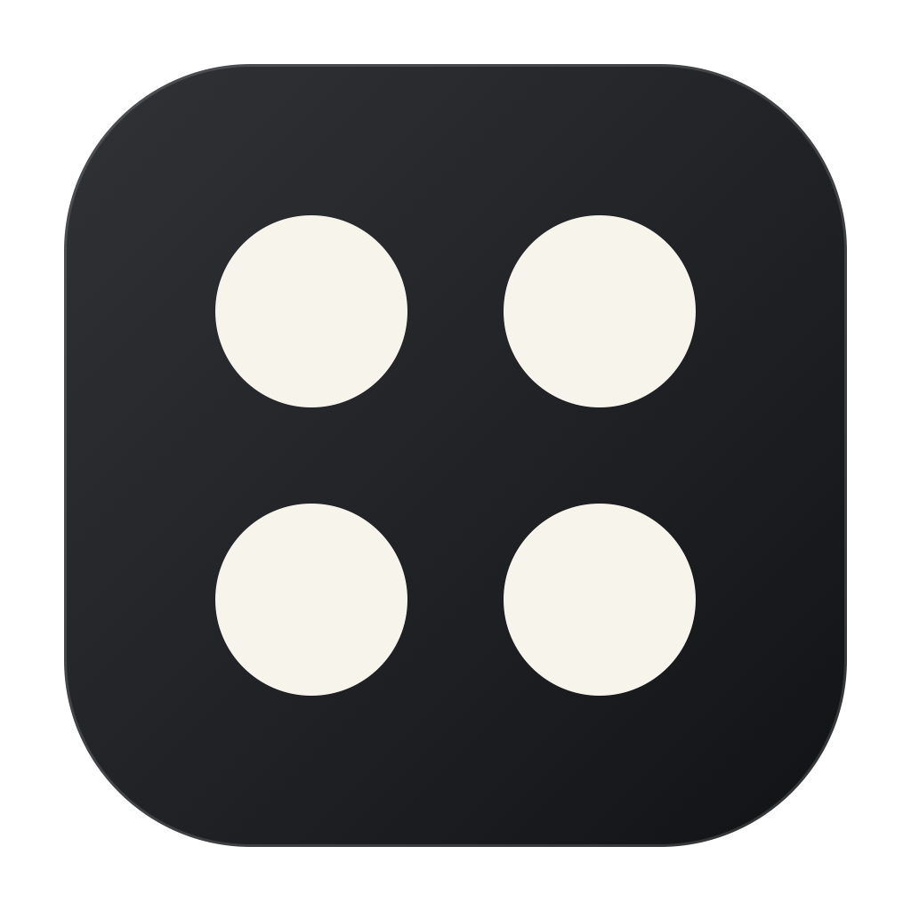
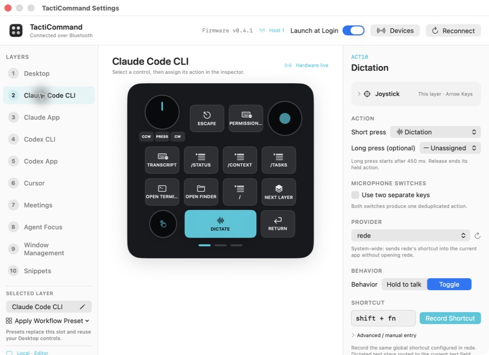
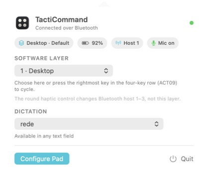

<p align="center">
  
</p>

<h1 align="center">TactiCommand</h1>

<p align="center"><strong>A local-first command surface for your micro controller.</strong></p>

<p align="center">
  <a href="https://github.com/aslomon/tacticommand/actions/workflows/ci.yml"></a>
  <a href="LICENSE"></a>
  
  
  
</p>

TactiCommand is an open-source native macOS menu bar app that turns a Work
Louder Creator Micro 2 or Codex Micro into a deeply configurable command
surface. It combines ten software layers, voice and dictation triggers,
keyboard automation, audio controls, pointer control, and live coding-agent
status in one SwiftUI app.

No account. No cloud service. No telemetry. No network listener.

Built for hands-on workflows across Claude Code CLI, the Claude app, Codex CLI,
the Codex app, Cursor, meetings, and everyday macOS control.

> TactiCommand is an unofficial, independent companion app. It is not
> affiliated with or endorsed by Work Louder, OpenAI, Anthropic, or Cursor.
> Creator Micro, Codex, ChatGPT, Claude, and Cursor are trademarks of their
> respective owners.

## Why it exists

Small tactile controllers are excellent at muscle-memory workflows, but their
usefulness should not stop at fixed keyboard shortcuts. TactiCommand gives each
physical control a context-aware role and makes the current state visible both
on screen and, where the hardware allows it, through RGB feedback.

## Highlights

- Ten configurable layers with Next, Previous, direct selection, and temporary
  frontmost-app rules.
- A short, non-activating HUD that confirms the active and next layer.
- Copy, Paste, Paste as Plain Text, reusable Slash Commands, text snippets, and
  recorded multi-key shortcuts.
- Safe 2–6-step action sequences built only from non-script actions.
- Rede, ChatGPT/Codex, Apple Dictation, and custom shortcut-driven providers.
- Input mute, output mute, and volume through CoreAudio.
- Live state inside on-screen keys: red microphone mute, orange output mute,
  green unmuted audio, teal dictation-toggle state, and cyan volume.
- Six RGB Agent keys for normalized Codex, Claude, and local-session state.
- Arrow-key, mouse-pointer, or disabled joystick behavior per layer.
- Connected-device inventory, USB/Bluetooth reconnect, and a direct path to the
  macOS Bluetooth pairing surface.
- App Intents plus a versioned, same-user Unix-domain RPC interface.

## See it in action

| Configuration editor | Menu bar control |
| --- | --- |
|  |  |

The Claude Code CLI preset displays its real key assignments directly. Live
agent-session names and colors appear only in the separate Agent Focus layer.

## Hardware compatibility

| Device | USB | Bluetooth LE | Status |
| --- | --- | --- | --- |
| Codex Micro / Creator Micro 2, VID `0x303A`, PID `0x8360` | Implemented | Observed | Primary target |
| Other Creator Micro revisions | Unknown | Unknown | Contributions welcome |

macOS owns pairing and discovery for Bluetooth HID devices. TactiCommand lists
compatible controllers currently available to the app and opens the correct
Bluetooth Settings surface for nearby or previously paired devices. Once macOS
connects the controller, TactiCommand detects it automatically.

Only the six Agent keys are individually RGB-addressable. Action keys share a
firmware backlight zone, so the app never pretends they can show independent
physical colors.

## Install from source

There is no notarized public binary release yet. Build from source on macOS 14+
with Xcode 16+, Swift 6, and XcodeGen 2.46+:

```bash
brew install xcodegen
git clone https://github.com/aslomon/tacticommand.git
cd tacticommand
./Scripts/verify.sh
open build/TactiCommand.app
```

The verification script runs strict formatting, a strict-concurrency build,
all tests, the universal app build, metadata checks, and signature validation.
Local builds use a stable self-signed development identity when configured and
otherwise fall back to ad-hoc signing. Neither is a notarized distribution
signature.

For stable local macOS permissions across rebuilds:

```bash
./Scripts/setup-local-signing.sh
./Scripts/build-app.sh
```

The local identity is limited to code signing and does not modify the TCC
database. A future downloadable release requires Developer ID signing,
Hardened Runtime, notarization, stapling, and published checksums.

## First run

1. Open **TactiCommand** and choose **Configure Pad** from its menu-bar icon.
2. Grant **Accessibility** so configured keyboard, pointer, app, and window
   actions can run.
3. Grant **Input Monitoring** so vendor HID events can be received.
4. Connect the controller over USB or choose its Bluetooth host profile.
5. Select a key in the pad canvas and assign an action in the inspector.

TactiCommand does not record audio. A selected dictation provider owns
microphone permission and speech processing.

## Layers in plain language

The default order is Desktop, Claude Code CLI, Claude App, Codex CLI, Codex App,
Cursor, Meetings, Agent Focus, Window Management, and Snippets.

- **Next Layer** advances once and wraps from Snippets back to Desktop.
- **Previous Layer** moves backward and wraps from Desktop to Snippets.
- **Select Layer…** always jumps directly to one chosen layer.

Every real layer change briefly shows the active layer and what Next would
choose. The controller's three Bluetooth host indicators are separate firmware
state and are never presented as one of the software layers.

The layer rail lets you explicitly rename any slot or replace it with a workflow
preset. Presets reuse the current Desktop chassis — terminal, Finder, quick
command, layer switch, dictation, Return, dial, and joystick — then replace the
six round-key actions for the selected environment. The confirmation step keeps
an existing custom mapping from being overwritten accidentally.

| Preset | Round-key focus |
| --- | --- |
| Desktop | Mute, click, Escape, app switch, Copy/Paste, Delete |
| Claude Code CLI | Cancel, permission mode, transcript, `/status`, `/context`, `/tasks` |
| Claude App | New chat, command palette, Copy, Paste, Find, Escape |
| Codex CLI | `/status`, `/diff`, `/review`, `/project`, `/worktree`, `/compact` |
| Codex App | New chat, command palette, terminal, `/project`, `/worktree`, `/side` |
| Cursor | Agent, new chat, Copy, Paste, submit, cancel generation |
| Meetings | Microphone mute and output mute |
| Agent Focus | Direct focus for six configured agent sessions |
| Browser | Address bar, tabs, reload, and Find |
| Window Management | Application and window switching |
| Writing | Copy, Paste, plain-text paste, select, undo, redo |
| Snippets | Six reusable prompt snippets |

Slash Commands type into whichever composer currently has keyboard focus.
Terminal and editor shortcuts may be customized by those apps, so every preset
remains fully editable.

## Text and command actions

- **Copy** sends `Command-C`.
- **Paste** sends `Command-V`.
- **Paste as Plain Text** sends `Option-Shift-Command-V`.
- **Type Text** inserts a fixed snippet in the focused field.
- **Slash Command** inserts a reusable command such as `/review` or `/compact`
  and can optionally submit it with Return. Its exact command is shown on the
  assigned key.
- **Keyboard Shortcut** records the exact physical chord, including `fn`,
  localized keys, modifier-only shortcuts, and ordered multi-key chords. Give
  it an optional name such as `Permission Mode`; that name appears directly on
  the assigned key, while unnamed shortcuts show their concrete chord.
- **Action Sequence** runs 2–6 safe built-in steps in order. Scripts,
  dictation, layer changes, agent focus, and nested sequences are excluded.

Shell and AppleScript actions are available for deliberate physical-key use.
They execute with the signed-in user's permissions; review them carefully.

## Agent focus

TactiCommand normalizes up to six recent Codex, Claude, or local process
sessions into idle, working, waiting, complete, error, and unavailable states.
Agent keys can focus a specific slot. **Focus Next Agent Needing Attention**
chooses waiting first, then error, then complete.

To derive this local view, the app reads bounded portions of recent Codex and
Claude JSONL files plus process/open-file metadata. Nothing is transmitted. See
[PRIVACY.md](PRIVACY.md) for the exact boundary.

## Local automation

The versioned endpoint is stored at the legacy-compatible path:

```text
~/Library/Application Support/CreatorMicroControl/Automation/control-v1.sock
```

Its parent directories use mode `0700`, the socket uses `0600`, and peer UID is
verified. Supported v1 methods are `status`, `listLayers`, `setLayer`, and
`triggerBinding`. Shell and AppleScript actions are rejected over RPC even when
they are allowed on a physical key.

Configuration remains at the legacy-compatible path below so upgrading from
Creator Micro Control to TactiCommand preserves existing mappings:

```text
~/Library/Application Support/CreatorMicroControl/configuration.json
```

Treat this file as sensitive; it may contain commands, paths, and snippets.

## Project map

```text
Sources/CreatorMicroCore/       Protocol, configuration, routing, agents
Sources/CreatorMicroControl/    AppKit/SwiftUI integration and macOS services
Tests/                          Unit and integration tests
Resources/                      App metadata and icon assets
Scripts/                        Reproducible build, signing, and verification
ThirdPartyNotices/              Interoperability attribution
```

Architecture details live in [SPEC.md](SPEC.md), visual decisions in
[DESIGN.md](DESIGN.md), and observed proof in [VALIDATION.md](VALIDATION.md).

## Contributing and security

Contributions are welcome under the [MIT License](LICENSE). Read
[CONTRIBUTING.md](CONTRIBUTING.md), [PRIVACY.md](PRIVACY.md), and
[SECURITY.md](SECURITY.md) before opening an issue or pull request.

Never upload a real configuration, session file, terminal history, device
serial number, personal path, or unredacted screenshot.

## Attribution

Hardware interoperability was independently implemented using protocol facts
documented by the MIT-licensed
[FreeMicro project](https://github.com/eliBenven/freemicro). The pinned source
reference and full license are included in
[ThirdPartyNotices/FreeMicro.md](ThirdPartyNotices/FreeMicro.md) and copied into
the app bundle.
